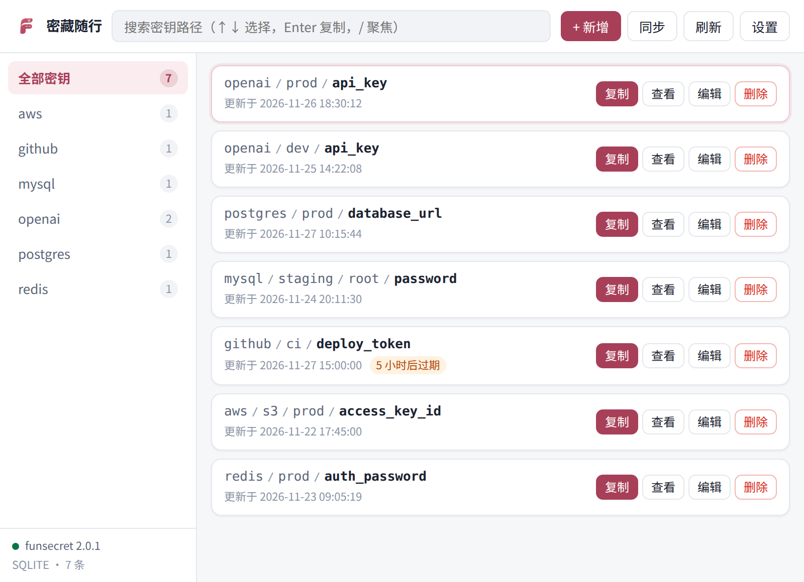
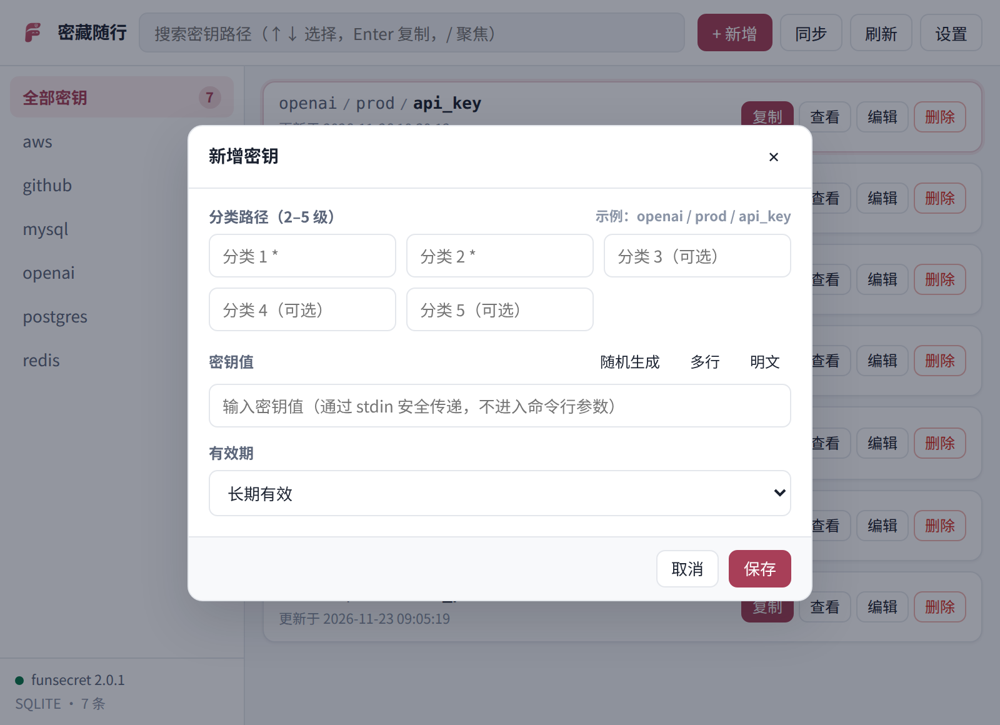
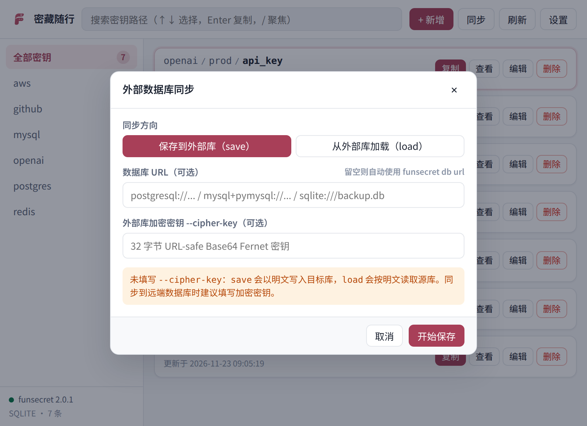
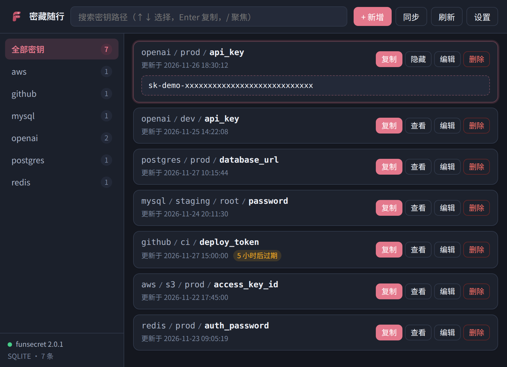

# 密藏随行 · FunSecret

<p align="center">
  
</p>

基于 [funsecret](https://github.com/farfarfun/funsecret) 原生命令行的 uTools 本地多级分类加密密钥管理插件：支持分类树浏览、实时模糊搜索、主搜索框直达复制、剪贴板自动清空、临时明文查看，以及 SQLite3 / MySQL / PostgreSQL 跨库同步。

## 功能预览

| 密钥分类树与搜索（浅色） | 新增 / 编辑密钥（支持前缀补全与 TTL） |
| :---: | :---: |
|  |  |

| 外部数据库同步（SQLite3 / MySQL / PG） | 深色模式与临时明文查看 |
| :---: | :---: |
|  |  |

## 核心特性

- **底层调用 `funsecret` CLI**：全部读写、Fernet 加密与跨库同步均由本机原生 Rust `funsecret` 命令完成（推荐 `funsecret >= 2.1.0`，可通过 `apt`、`brew`、`cargo install funsecret` 或 GitHub Release 获取）。
- **分类树浏览与实时搜索**：按 2–5 级分类路径展示（如 `openai / prod / api_key`），列表视图默认不读取也不显示任何密钥明文。
- **按需读取与安全复制**：点击或回车才调用 `funsecret read`；支持剪贴板自动清空倒计时（默认 30 秒）与临时明文查看自动隐藏（默认 15 秒）。
- **安全写入与单条删除**：通过 `write --stdin` 安全传递多行或 `-` 开头的密钥值，不进入命令行参数；支持可选 TTL 过期时间与 `delete` 单条删除。
- **uTools 主搜索框直达（`mainPush`）**：直接在 uTools 主框搜路径回车复制，无需打开插件窗口。
- **多数据库无缝同步**：可视化调用 `funsecret save` / `funsecret load`，支持 SQLite3、MySQL（含 MariaDB）与 PostgreSQL（兼容 SQLAlchemy 方言 URL 前缀）以及 `--cipher-key`。

## uTools AI / MCP 工具

插件在启动时通过 `utools.registerTool` 注册以下只读工具，供 uTools AI 或开启 MCP 服务后的第三方 Agent 调用（**严格只返回分类路径与更新时间，绝不输出任何密钥明文值**）：

| 工具名 | 说明 |
| --- | --- |
| `list_secret_paths` | 按可选关键词检索本机 `funsecret` 已保存的密钥分类路径与更新时间（最多 50 条），不含密钥值 |

## 数据与隐私说明

- **所有密钥仅保存在本机 `funsecret` 数据库中**（默认 `~/.secret/.funsecret.db`，文件权限 `0600`），插件绝不将任何密钥明文写入 `utools.dbStorage`（因此不会进入 uTools 云同步）。
- 仅非敏感偏好设置（自定义 `funsecret` 路径、`FUN_SECRET_PATH` / `FUN_SECRET_URL` 覆盖、剪贴板自动清空秒数、主题）保存在 `utools.dbStorage`。
- 外部同步功能仅在用户主动触发 `save` / `load` 时连接用户指定的数据库；未填写 `--cipher-key` 时目标库以明文存储。

## 本地开发与验证

```bash
pnpm install
sh build.sh
```

运行单元测试与自动截图检查：

```bash
pnpm test
pnpm screenshots
```

构建产物输出在 `utools/dist/`，在 uTools 开发者工具中载入 `utools/plugin.json` 即可调试。打包 `.upxs` 发布说明见 [docs/release-upxs.md](docs/release-upxs.md)。

## 开源协议

[MIT](LICENSE)
